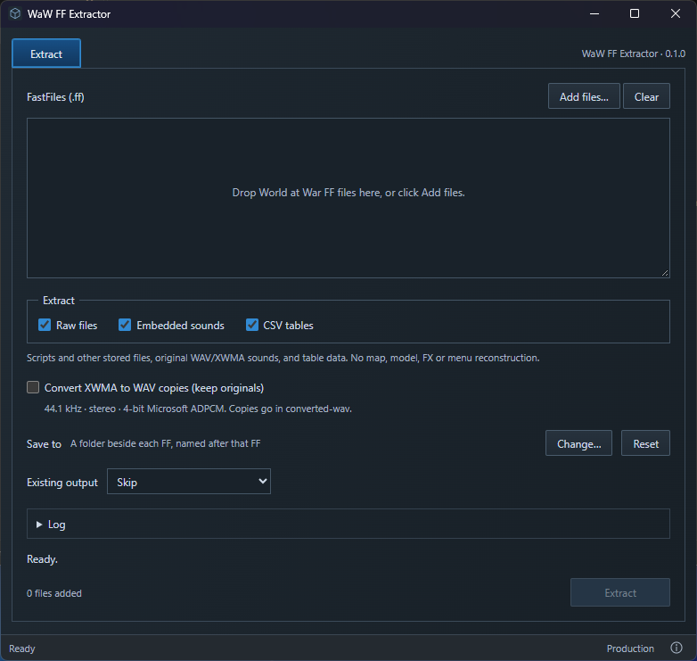

# WaW FF Extractor

**An unofficial community app. Not affiliated with Treyarch, Activision, UGX or Tom_Bmx.**

Extract raw files (scripts etc.), embedded sounds and CSV tables from PC World at War `.ff` files. Inspired by Tom_Bmx's extractor. Made by [phil81334](https://github.com/phil81334). Built with JavaScript, Rust, Vite and Tauri, using OpenAssetTools for extraction and FFmpeg for optional sound conversion.



[Extraction result screenshot](images/waw-ff-extractor-extraction-result.png)

## Download and run

1. Have World at War installed. **No Modtools needed.**
2. Open [Releases](https://github.com/phil81334/waw-ff-extractor/releases/latest). Under **Assets**, download **waw-ff-extractor.exe**. The source archives are for development.
3. Put the EXE in the folder containing `CoDWaW.exe`, then double-click it.

You do not need Node.js, Rust, Git or VS Code to use the EXE. Needs Windows 10/11, [WebView2](https://developer.microsoft.com/microsoft-edge/webview2/#download-section) and the [Microsoft Visual C++ x86 Runtime](https://aka.ms/vs/17/release/vc_redist.x86.exe). These may already be installed; if WebView2 is missing, install its **Evergreen Bootstrapper**.

## Extract files

Drag in FF files, or click **Add files** to open `zone/english`. Choose what to extract and click **Extract**. Each FF gets its own output folder beside it; **Change…** lets you choose another location.

**Skip** leaves matching paths untouched without comparing contents. **Replace** overwrites matching files but leaves unrelated old files. **Back up folder, then replace** renames the whole old folder to `<FF name>.backup-1` (then `.backup-2`, etc.) and creates fresh output. Use this when switching from another extractor to avoid mixing outputs.

Raw files and embedded sounds keep their stored bytes. CSV tables keep their stored cells, with recreated CSV formatting. No map, model, FX or menu reconstruction, external sound extraction or referenced-sounds list. Source FF files are not changed.

**Convert XWMA to WAV copies** is optional and off by default. It keeps the originals and adds 44.1 kHz, stereo, 4-bit Microsoft ADPCM WAVs under `converted-wav/sound/...`, following [this WaW sound guide](https://wiki.zeroy.com/index.php/Call_of_Duty_5:_Sounds). The format is checked automatically; in-game use has not been tested.

Each successful extraction saves `waw-ff-extractor-log.txt` (numbered if already present). Extracted files named after the FF may contain old compiler errors stored in the FF itself—not errors from this app.

## Run from source

**Windows setup — do this once.** Skip anything already installed. The runtime requirements above also apply.

| Install | What to choose |
| --- | --- |
| [VS Code](https://code.visualstudio.com/) | The Windows installer. This is where you open the project. |
| [Node.js](https://nodejs.org/en/download) | **LTS**, **Windows**, **Installer (.msi)**, version 22.12 or newer. Keep the defaults; npm is included. |
| [Git for Windows](https://git-scm.com/downloads/win) | The standard Windows installer, including Git Bash. Keep Git available from the command line and third-party software. Required even if you download this project as a ZIP: the engine build uses Git. |
| [Microsoft C++ Build Tools](https://visualstudio.microsoft.com/downloads/#build-tools-for-visual-studio-2022) | Use **Visual Studio 2022 Build Tools**, select **Desktop development with C++**, and include the **MSVC v143 x64/x86 tools** and a **Windows SDK**. |
| [Rust](https://rust-lang.org/tools/install/) | Download and run **rustup-init.exe (x64)**. Choose the default installation. |

Close and reopen VS Code after installing these. [Tauri's Windows guide](https://v2.tauri.app/start/prerequisites/#windows) has more help. Vite, Tauri and the engine/audio build tools are downloaded by the project; no separate Python installation is needed.

**Open and run the project:**

1. On this GitHub page, choose **Code → Download ZIP**, then extract it. You can clone it instead if you already use Git.
2. In VS Code, choose **File → Open Folder**. Open the extracted folder containing `package.json`.
3. Choose **Terminal → New Terminal**, then run these commands one at a time:

   ```powershell
   npm install
   npm run dev
   ```

`npm install` downloads the project's dependencies. `npm run dev` opens the desktop app. The first run downloads and compiles Rust dependencies, OpenAssetTools and the audio converter, so give it several minutes. Later runs reuse these builds. Keep the terminal open; press **Ctrl+C** there to stop development.

Development does not require the app to be in the game folder. It defaults to `.local/test-root`; you can still browse to or drag in your FF files. Extraction writes beside the selected FF unless you choose another output folder, so choose a separate test folder when testing.

Optionally, to start **Add files** in your game’s `zone/english`, create `.local/game-path.txt` in the project. In Windows File Explorer, open the folder containing `CoDWaW.exe`, click the address bar and copy its full address into that file. Save one line, with no quotes or EXE filename. Restart development after changing it. If the file is missing or blank, the `.local/test-root` default stays in use. An explicit `WAW_ROOT` environment setting takes priority. The packaged EXE always uses its own folder.

Next time, run `npm run dev`, or click the play button beside **dev** in VS Code's **NPM Scripts** panel. If that panel is hidden, right-click the Explorer panel headings and enable **NPM Scripts**.

| Command | What it does |
| --- | --- |
| `npm run dev` | Opens the desktop app for development. |
| `npm run dev:web` | Shows the UI in a browser. Cannot extract files. |
| `npm run build` | Creates `release/waw-ff-extractor.exe`. |
| `npm run build:web` | Builds the UI files only. No EXE. |

To make your own EXE, run `npm run build`, then copy `release/waw-ff-extractor.exe` beside `CoDWaW.exe`.

[Credits and engine source](ATTRIBUTION.md) · [GPL-3.0 licence](LICENSE)
